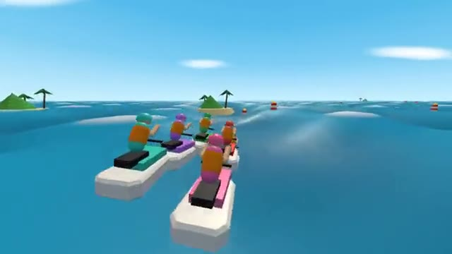

# Wave Racers

Jet skis, big waves, buoys. Miss one: +2 seconds. A multiplayer starter game from [Multiplayer Agent](https://multiplayeragent.com): 3D, versus, 2–8 players, with bots that fill empty seats.

## How it plays

Race jet skis three laps around the islands on a rolling sea. Steer between every pair of buoys, fly off the wave crests and keep your line; each missed gate adds 2 seconds to your time.

**Controls:** Arrow keys or A/D to steer, Down or Space to brake into tight turns, or on-screen buttons.

## Make it yours in the Game Builder

Open the [Game Builder](https://multiplayeragent.com), choose **Start from a starter game** and pick Wave Racers. It opens as version 1 in your studio, ready to play and publish. Then ask for changes, for example:

- Make the waves bigger and add a storm
- Add boost rings floating between the gates
- Turn it into a night race with glowing buoys

## Run it yourself

1. Get a free publishable key (`pk_…`) at [multiplayeragent.com](https://multiplayeragent.com).
2. In `index.html`, put it in place of `pk_REPLACE_ME` in the `MP_CONNECT` block.
3. Serve the folder (for example `npx serve`) and open it. The 3D engine loads as a module, which browsers block from a file on disk.

Without a key it still runs, offline against bots.

## How it is built

- One `index.html`, plus three.js in `libs/`. The comment at the top of the script maps the code and explains the multiplayer.
- **Leaderboard:** The fastest three-lap races, penalties included.
- **Host-run rounds:** The host's browser starts each race and posts the results; if it leaves, the next player takes over.
- **Bots:** Bots race the line, and now and then miss a gate, until enough people join.
- **Live sync:** Every jet ski rides the same waves for everyone at once.
- `?attract` runs it offline with bots only. The preview video is recorded from it.

## License

MIT.
